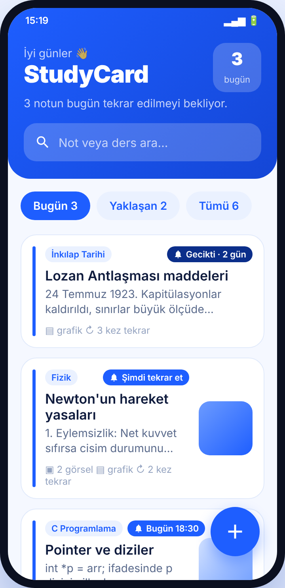
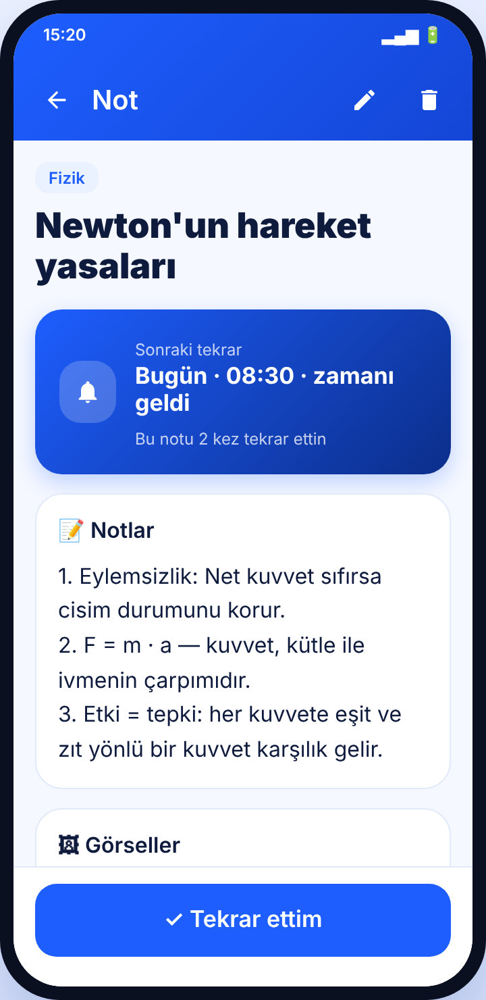
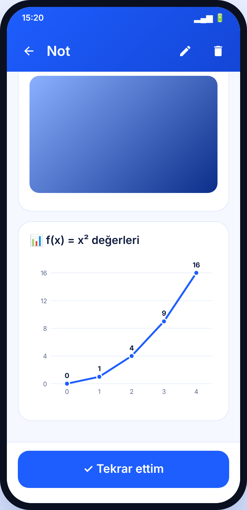
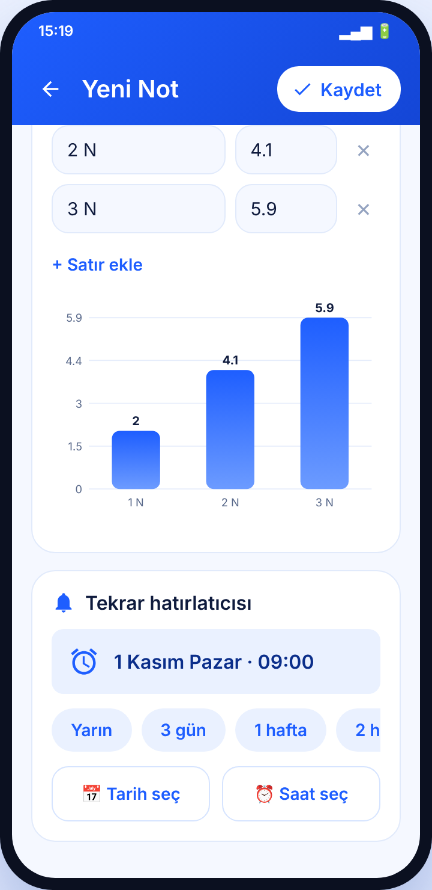
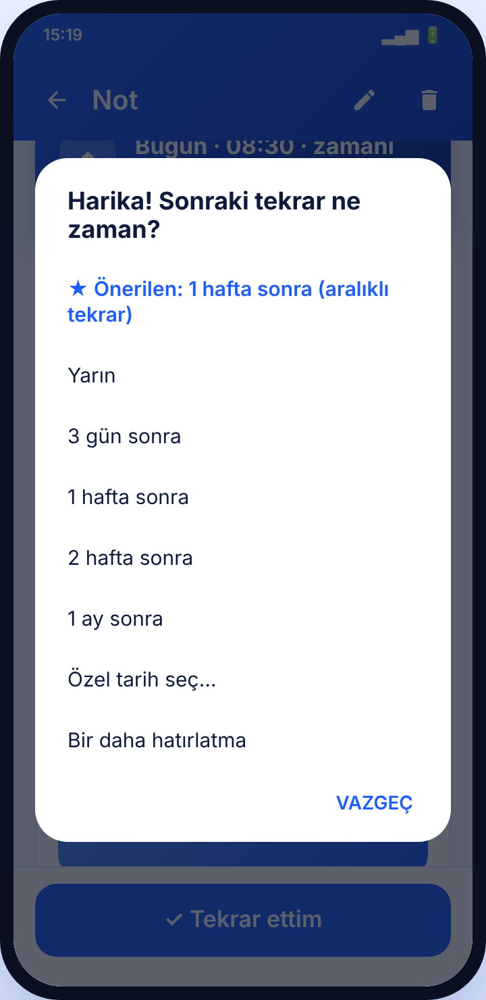
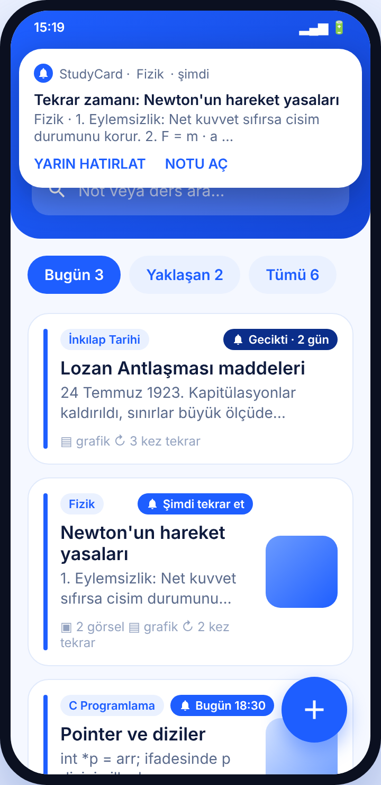

<div align="center">


# StudyCard

**Ders notlarını kaydet, tekrar gününü seç, zamanı gelince bildirim al.**

Yazı, görsel ve grafik destekli; aralıklı tekrar mantığıyla çalışan bir ders notu hatırlatıcısı.


-0B2E8A?style=flat-square)


</div>

---

## 📱 Ekran görüntüleri

<table>
  <tr>
    <td align="center"><br><b>Ana ekran</b></td>
    <td align="center"><br><b>Not detayı</b></td>
    <td align="center"><br><b>Grafikli not</b></td>
  </tr>
  <tr>
    <td align="center"><br><b>Not ekleme</b></td>
    <td align="center"><br><b>"Tekrar ettim"</b></td>
    <td align="center"><br><b>Tekrar bildirimi</b></td>
  </tr>
</table>

## ✨ Özellikler

- **📝 Not ekleme:** Ders adı (otomatik tamamlamalı), başlık ve not metni
- **🖼 Görseller:** Galeriden çoklu seçim veya kamerayla çekim; otomatik küçültme ve döndürme düzeltmesi; tam ekran görüntüleme ve iki parmakla yakınlaştırma
- **📊 Grafikler:** Etiket + değer satırlarıyla **çubuk, çizgi ve pasta** grafik, canlı önizleme
- **🔔 Tekrar hatırlatıcısı:** Hızlı seçim (Yarın, 3 gün, 1 hafta, 2 hafta, 1 ay) veya özel tarih + saat
- **📬 Bildirimler:** Tekrar zamanı gelince görselli bildirim; dokununca not açılır, **"Yarın hatırlat"** ile ertelenir
- **🔁 Aralıklı tekrar:** "Tekrar ettim" dediğinde bir sonraki aralığı önerir (1 → 3 → 7 → 14 → 30 → 60 gün)
- **🗂 Sekmeler ve arama:** Bugün / Yaklaşan / Tümü; başlık, ders ve içerikte arama
- **♻️ Kalıcı hatırlatıcılar:** Telefon yeniden başlatıldığında alarmlar otomatik geri kurulur
- **🔒 Çevrimdışı:** Tüm veriler cihazda (SQLite) kalır, internet izni yoktur

## 📥 İndir

En son APK'yı **[Releases](../../releases)** sayfasından indirip telefonuna kurabilirsin.

> Kurulumda "bilinmeyen kaynak" izni istenebilir. İlk açılışta bildirim iznini, ana ekranda uyarı görürsen **tam zamanlı alarm** iznini ver.

## 🛠 Derleme

### Android Studio
1. Depoyu klonla: `git clone https://github.com/<kullanıcı-adın>/StudyCard.git`
2. Android Studio'da **File → Open** ile klasörü aç.
3. Gradle senkronizasyonu bitince ▶ **Run**.

### Komut satırı
```bash
./gradlew assembleDebug
# Çıktı: app/build/outputs/apk/debug/app-debug.apk
```
JDK 17 ve Android SDK (API 35) gerekir.

### GitHub Actions
Her `main` push'unda [`.github/workflows/build.yml`](.github/workflows/build.yml) debug APK'yı derler. **Actions** sekmesindeki çalıştırmanın altından **StudyCard-debug-apk** dosyasını indirebilirsin.

## 🧱 Mimari

Uygulama yalnızca Android framework'üyle yazıldı; harici kütüphane yoktur.

```
app/src/main/java/com/studycard/app/
├── MainActivity.java        Ana ekran: sekmeler, arama, liste
├── EditNoteActivity.java    Not ekleme/düzenleme: yazı, görsel, grafik, tarih
├── NoteDetailActivity.java  Not görüntüleme + "Tekrar ettim"
├── NoteAdapter.java         Liste kartları
├── ChartView.java           Özel çizim: çubuk / çizgi / pasta grafik
├── ImageViewerDialog.java   Tam ekran görsel, yakınlaştırma
├── Note.java                Veri modeli
├── NoteDb.java              SQLite veritabanı
├── ImageStore.java          Görsel kaydetme, küçültme, EXIF düzeltme
├── ImageProvider.java       Kamera çıktısı için içerik sağlayıcı
├── ThumbLoader.java         Arka planda küçük resim yükleme + önbellek
├── ReminderScheduler.java   AlarmManager ile hatırlatıcı kurma
├── ReminderReceiver.java    Bildirim gösterme, "Yarın hatırlat"
├── BootReceiver.java        Yeniden başlatmada alarmları geri kurma
├── App.java                 Bildirim kanalı
└── Ui.java                  Tarih biçimleri, kenardan kenara görünüm
```

| Konu | Çözüm |
|---|---|
| Veri saklama | `SQLiteOpenHelper` |
| Hatırlatıcı | `AlarmManager.setExactAndAllowWhileIdle` (izin yoksa esnek alarm) |
| Bildirim | `NotificationChannel` + `BigPictureStyle` / `BigTextStyle` |
| Görseller | Uygulamanın özel klasörü, sıkıştırılmış JPEG |
| Grafik | `Canvas` ile özel `View` |

## 🔐 İzinler

| İzin | Neden |
|---|---|
| `POST_NOTIFICATIONS` | Tekrar bildirimlerini göstermek (Android 13+) |
| `SCHEDULE_EXACT_ALARM` | Bildirimin tam zamanında gelmesi (Android 12+) |
| `RECEIVE_BOOT_COMPLETED` | Telefon açılınca hatırlatıcıları geri kurmak |
| `VIBRATE` | Bildirim titreşimi |

Kamera izni istenmez; fotoğraf telefonun kendi kamera uygulamasıyla çekilir.

> **Not:** Bazı üreticiler (Xiaomi, Huawei, Oppo vb.) pil tasarrufu için arka plan alarmlarını kısıtlayabilir. Bildirim gelmezse StudyCard için pil optimizasyonunu kapat.

## 🗺 Yol haritası

- [ ] Karanlık tema
- [ ] Notları ders klasörlerine ayırma
- [ ] Yedekleme / dışa aktarma
- [ ] Ana ekran widget'ı ("bugünkü tekrarlar")
- [ ] Tekrar istatistikleri

---

<div align="center">
<sub>Java ile ❤️ ve bolca tekrarla yapıldı.</sub>
</div>
